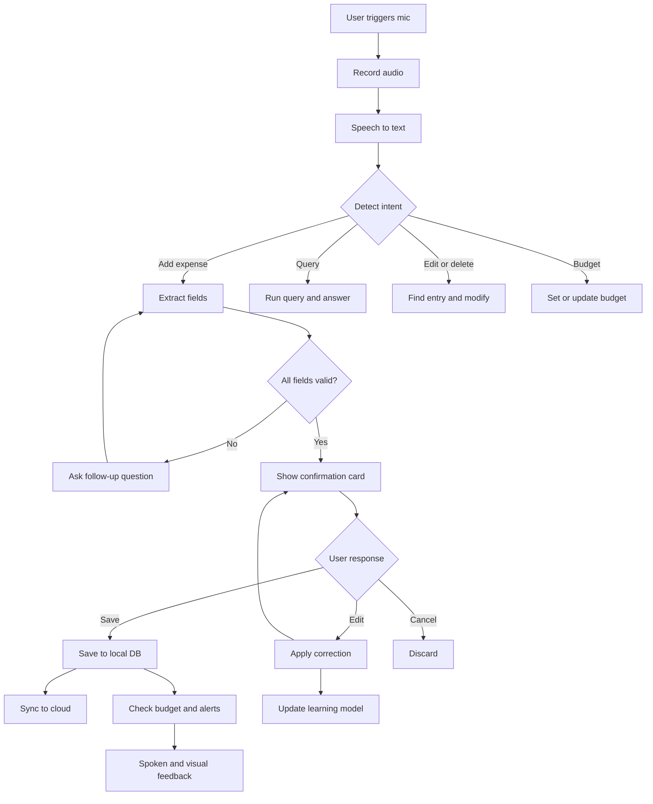
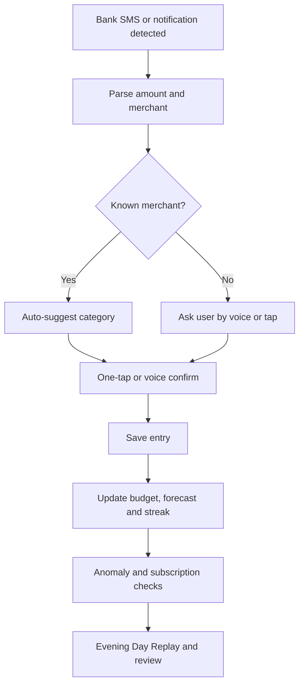

# Voice Expense Tracker — Functionalities and Workflow

A hands-free expense tracker where the user speaks ("Spent 250 on lunch at Paradise using UPI") and the app records, categorizes and reports it.

This document is the product target. For what is implemented today, see the
"Status in this build" section at the end.

---

## 1. Core Idea

| Goal | How voice helps |
|------|-----------------|
| Log an expense in under 5 seconds | Speak instead of typing amount, category, date, payment mode |
| Zero friction capture | One tap or wake phrase starts listening |
| Accurate data | Confirmation step catches misheard numbers |
| Useful insights | Spoken queries like "How much did I spend on food this month?" |

---

## 2. Functionalities

### 2.1 Voice Capture
- Push-to-talk (tap and hold mic button)
- Tap-to-start with auto-stop on silence (about 1.5 s)
- Optional wake phrase ("Hey Tracker") for hands-free use
- Home-screen widget / quick tile / lock-screen shortcut for one-tap launch
- Offline recording: audio is queued and processed when the network returns
- Multi-language support: English, Hindi, Telugu and mixed speech (Hinglish); auto language detection

### 2.2 Speech-to-Text (STT)
- Streaming transcription with live on-screen text
- Custom vocabulary: merchant names (Swiggy, Zomato, DMart), Indian number formats ("two lakh", "paanch sau")
- Noise handling and confidence score per word

### 2.3 Natural Language Understanding (NLU)

| Field | Example phrase | Extracted value |
|-------|----------------|-----------------|
| Amount | "spent 250" / "two fifty" / "ek hazaar" | 250 / 250 / 1000 |
| Currency | "20 dollars" | USD (default INR) |
| Category | "lunch", "petrol", "movie" | Food, Fuel, Entertainment |
| Merchant | "at Paradise", "from Amazon" | Paradise, Amazon |
| Date | "yesterday", "last Friday", "on the 5th" | Resolved date (default today) |
| Payment mode | "by UPI", "cash", "credit card" | UPI / Cash / Card |
| Note | "for team lunch" | Free-text note |
| Type | "received 5000 salary" | Income vs Expense |
| Split | "split with Ravi and Anil" | Shared expense, 3 people |
| Recurring | "every month rent 15000" | Recurring rule |

### 2.4 Multi-Expense in One Utterance
"Spent 100 on tea, 400 on auto and 1200 on groceries" creates 3 separate entries, shown as a list for one-tap confirmation.

### 2.5 Smart Categorization
- Rule-based keywords first (fast, offline)
- ML/LLM fallback for ambiguous items
- Learns from corrections: if the user changes "Uber" from Travel to Work, it remembers
- Custom categories and sub-categories (Food → Groceries, Dining, Snacks)

### 2.6 Confirmation and Correction
- Confirmation card: amount, category, date, mode, shown on screen and optionally read aloud
- Voice commands: "Yes / Save", "Cancel", "Change amount to 300", "Make it Travel", "Date yesterday"
- Auto-save mode for trusted high-confidence entries (user toggle)
- Undo toast for 10 seconds after save

### 2.7 Voice Queries (Ask Your Data)

| User says | App does |
|-----------|----------|
| "How much did I spend today?" | Sums today's expenses, speaks and shows the total |
| "Food spending this month?" | Category total with comparison to last month |
| "Biggest expense this week?" | Returns top transaction |
| "Show last 5 expenses" | Displays and reads the list |
| "Am I over budget on shopping?" | Compares to the budget and answers |

### 2.8 Budgets and Alerts
- Monthly budget per category and overall
- Voice setup: "Set food budget to 8000"
- Threshold alerts at 50%, 80%, 100%
- Spoken or push alert right after saving: "Food is at 85% of budget"

### 2.9 Reports and Insights
- Daily, weekly, monthly summaries
- Charts: category pie, daily trend line, payment mode split
- Weekly spoken digest
- Export to CSV, XLSX and PDF
- Month-end report share via WhatsApp or email

### 2.10 Receipts and Attachments (optional)
- Attach a photo of a receipt to an entry
- OCR to cross-check the spoken amount

### 2.11 Sync, Backup, Privacy
- Local-first storage (works offline)
- Encrypted cloud sync across devices
- Audio is deleted after transcription by default (user toggle to keep it)
- App lock with biometric/PIN
- Data export and delete-all option

### 2.12 Accessibility
- Fully voice-operable and screen-reader compatible
- Text-to-speech confirmations (toggle)
- Large-text and high-contrast modes

---

## 3. Perfect Workflow (Primary Flow)

```
1. USER TRIGGERS      tap mic / widget / wake phrase
2. LISTEN             record audio, show live waveform
3. SPEECH-TO-TEXT     streaming transcript on screen
4. INTENT DETECTION   add expense? query? edit? budget?
5. EXTRACT FIELDS     amount, category, date, mode, note
6. VALIDATE           missing amount / low confidence / duplicate
7. CONFIRMATION CARD  voice or tap: Save / Edit / Cancel
8. SAVE               local DB, then queue sync
9. FEEDBACK           "Saved Rs 250 for Food" + budget status + undo
10. LEARN             merchant to category mapping from corrections
```



---

## 4. Example Conversations

**Happy path:** "Spent 250 on lunch at Paradise by UPI." -> card shows Rs 250, Food, Paradise, UPI, today -> "Saved."

**Missing info:** "Paid for petrol." -> "How much was it?" -> "Eight hundred." -> "Saved Rs 800 under Fuel."

**Correction:** "Bought shoes for 2,999." -> card shows Shopping, Rs 2,999 -> "Change category to Gifts." -> "Updated."

**Multiple items:** "Tea 20, auto 150, groceries 900." -> 3 entries -> "Yes" -> "3 expenses saved, total Rs 1,070."

**Query:** "How much did I spend on food this month?" -> "Rs 4,320 on food, 18% more than last month."

---

## 5. Edge Cases and Error Handling

| Situation | Handling |
|-----------|----------|
| Background noise / unclear audio | Ask to repeat; show transcript for manual fix |
| Number ambiguity ("fifteen" vs "fifty") | Always show amount large on the confirmation card |
| No internet | Use on-device STT/rules; queue sync |
| Unknown merchant | Category "Uncategorized"; ask once, then remember |
| Relative dates ("last Monday") | Resolve using the device timezone; show the resolved date |
| Duplicate entry | Warn if same amount and merchant within 2 minutes |
| Mic permission denied | Fallback to typing field with quick-add chips |
| Mixed language | Detect per sentence; normalize numerals |
| Accidental trigger | Auto-cancel if no speech detected in 5 seconds |
| Very large amount (> 50,000) | Extra confirmation prompt |

---

## 6. Data Model

```
Expense
  id, amount, currency, type [expense|income], category_id, merchant,
  payment_mode [cash|upi|card|netbanking|other], date, note, source,
  raw_transcript, confidence, split_with, recurring_id, receipt_url,
  created_at, updated_at, synced_at

Category      id, name, icon, color, parent_id, keywords[]
Budget        id, category_id?, period, limit_amount
RecurringRule id, frequency, next_run, template_expense
MerchantMap   merchant -> category_id (learned)
```

---

## 7. Suggested Tech Stack

| Layer | Options |
|-------|---------|
| App | Flutter or React Native |
| STT | Whisper (on-device or API), Google Speech-to-Text, Deepgram |
| NLU | Rule parser + LLM (structured JSON output) |
| TTS | Platform TTS (Android/iOS) |
| Local DB | SQLite / Isar / WatermelonDB |
| Backend | Supabase / Firebase / Node + Postgres |
| Auth | Email, phone OTP, biometric |
| Charts | fl_chart / Victory / Recharts |

### LLM Parsing Prompt (example)

```text
Extract expense details from the sentence. Return JSON only:
{ "entries": [ { "amount": number, "currency": "INR",
  "category": string, "merchant": string|null,
  "date": "YYYY-MM-DD", "payment_mode": string|null,
  "note": string|null, "type": "expense|income" } ],
  "missing_fields": [], "confidence": 0-1 }
Today is {{today}}. Default currency is INR.
```

---

## 8. Screens

1. Home: today's total, big mic button, recent entries
2. Listening overlay: waveform and live transcript
3. Confirmation card: editable fields, Save / Cancel
4. Transactions: searchable list with filters
5. Insights: charts, trends, weekly digest
6. Budgets: progress bars per category
7. Settings: language, auto-save, voice feedback, privacy, export

---

## 9. Build Roadmap

| Phase | Scope |
|-------|-------|
| MVP | Voice add (single expense), confirmation, local storage, list view, daily/monthly totals |
| V1 | Multi-expense utterance, voice queries, categories, budgets and alerts, CSV export |
| V2 | Multi-language, learning from corrections, recurring entries, cloud sync, reports |
| V3 | Receipt OCR, split expenses, bank/SMS import, wake phrase, wearable support |

---

## 10. Success Metrics

- Time to log an expense: under 5 seconds
- Parsing accuracy (amount + category): above 95%
- Corrections per 100 entries: below 10
- Daily active logging rate and 30-day retention
- Share of entries logged by voice vs manual

---

## 11. Perfect-Workflow Checklist

- [ ] One-tap access from the home screen or widget
- [ ] Live transcript so the user sees what was heard
- [x] Every entry confirmed (or auto-saved only at high confidence)
- [x] Voice and tap correction both supported
- [ ] Offline capture works without data
- [x] Undo available after every save
- [x] Budget feedback right after saving
- [ ] Learns from corrections over time
- [x] Audio deleted by default; data exportable and deletable

---

## 12. Status in this build

This project is a local Streamlit app backed by SQLite. It is not a mobile
application, so a few spec items need a different client.

| Spec area | Status |
|-----------|--------|
| Voice capture, transcription, editable transcript, confirmation before save | Implemented |
| Multi-expense in one utterance, quantities ignored, relative dates | Implemented |
| Merchant, payment mode, income vs expense detection | Implemented |
| Duplicate warning (same amount within 2 minutes) | Implemented |
| Categories, khata ledger, partial khata payments, budgets, alerts | Implemented |
| Voice and typed Q&A over your own data | Implemented |
| History filters, inline edit and delete, undo, CSV/JSON export | Implemented |
| Backup restore with preview | Implemented |
| Hinglish, Telugu and English UI | Implemented |
| Per-category budgets, voice budget setup | Not yet |
| Receipt photo + OCR, split expenses, recurring rules | Not yet |
| Learned merchant-to-category corrections | Not yet |
| XLSX/PDF export, WhatsApp/email share | Not yet |
| Wake phrase, home-screen widget, lock-screen shortcut, offline queue | Not possible in a browser-hosted Streamlit page; needs a mobile client |
| Biometric app lock, encrypted cloud sync | Not possible locally; needs a backend and native APIs |
| Text-to-speech confirmation | Not yet; would need a browser speech component |

---

## 13. Innovative Features

### 13.1 Capture Innovations

| Feature | What it does |
|---------|--------------|
| Ambient Mode | Say "Trip mode on" and narrate through the day; one review screen at night. |
| Voice + Camera Combo | Point the camera at a bill and say "split this with the team". |
| Whisper Logging | Low-volume speech support for public places. |
| Wearable and Car Mode | Log from a watch, earbuds long-press, or Android Auto/CarPlay. |
| Smart Notification Prompt | A bank/UPI SMS becomes "Swiggy, Rs 450. Food?" and is confirmed in one tap. |
| Location-Aware Suggestions | Near a known merchant, pre-fill category and merchant. |
| Habit Shortcuts | Personal phrases: "usual chai" = Rs 20 Food Cash. |

### 13.2 AI-Powered Intelligence

- Conversational advisor: "Why was this month so expensive?"
- Anomaly detection: "This Rs 3,200 dining expense is 4x your usual."
- Spending forecast: predicted month-end total and the date a budget is crossed.
- Subscription hunter: detect repeating small charges.
- What-if simulator: "What if I cut eating out by 30%?"
- Mood and context tags (off by default, local only).
- Auto-learning vocabulary: slang, nicknames, regional phrases.

### 13.3 Social and Shared Money

Voice split and settle, family pool, trip ledger with multi-currency, group challenge.

### 13.4 Motivation and Behavior Change

Spending coach personality, savings goals by voice, round-up savings, streaks and
badges, pause before you buy, weekly voice recap.

### 13.5 Trust, Privacy and Accessibility

On-device AI mode, voiceprint lock, privacy redaction, mid-sentence multilingual
switching, elder and low-literacy mode.

### 13.6 Signature Feature Ideas

Day replay, money memory, voice budget negotiation, receipt-to-voice cross-check,
financial health score.

### 13.7 Innovation Workflow (Ambient + Smart Prompt)



### 13.8 Recommended Innovation Priority

| Priority | Feature | Why |
|----------|---------|-----|
| High | Ambient Mode, SMS-to-voice prompt, Habit Shortcuts | Biggest reduction in effort per entry |
| High | Conversational Advisor, Anomaly Detection | Turns logging into real insight |
| Medium | Voice Split and Settle, Savings Goals | Strong daily-use hooks |
| Medium | Weekly Voice Recap, Day Replay | Emotional engagement and retention |
| Later | Voiceprint Lock, Mood Tags, Wearables | Polish and differentiation |

---

## 14. Innovation Feasibility in This Build

| Innovation | Verdict | Notes |
|------------|---------|-------|
| Spending forecast | Implemented | Pace-based month-end projection and the day the budget is crossed |
| Anomaly detection | Implemented | Flags an expense at 3x the category median, once a category has 3+ entries |
| Smart notification prompt | Partly implemented | Paste a bank/UPI SMS and it becomes a confirmable entry; reading notifications needs a native app |
| Habit Shortcuts | Not yet | Needs a user-editable phrase table; the one-tap chips are the current stand-in |
| Ambient Mode | Not yet | Needs a session mode that saves without confirmation, plus a nightly review screen |
| Conversational advisor | Partly | Rule-based Q&A answers period, category, budget and forecast questions; open-ended reasoning needs an LLM |
| Voice split and settle | Not yet | Khata covers two-party lending, not multi-person splits |
| Subscription hunter | Not yet | Needs 3+ months of history to be reliable |
| What-if simulator | Not yet | Straightforward once a scenario form exists |
| Bank SMS/notification reading | Not possible here | Requires Android SMS permission or notification access |
| Location-aware suggestions | Not possible here | Requires device location and a merchant map |
| Wearable, car, widget, wake phrase | Not possible here | Requires a mobile client; a browser tab cannot listen in the background |
| Voiceprint lock, biometric lock | Not possible here | Requires native biometrics and a voiceprint model |
| Encrypted cloud sync, family pool | Not yet | Needs a backend, accounts and key management |
| Day replay, weekly voice recap | Not yet | Needs TTS; the text digests already exist |
